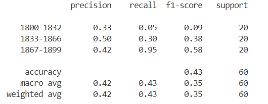
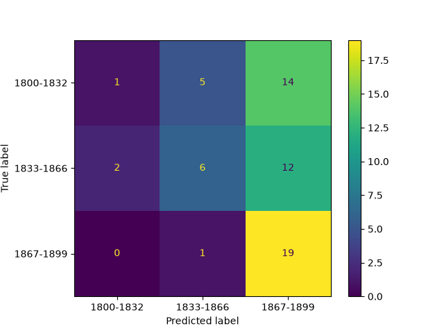
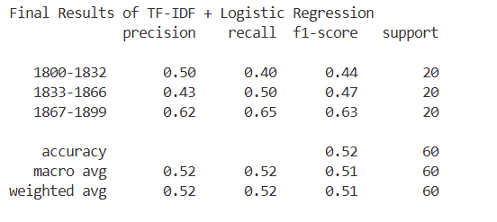
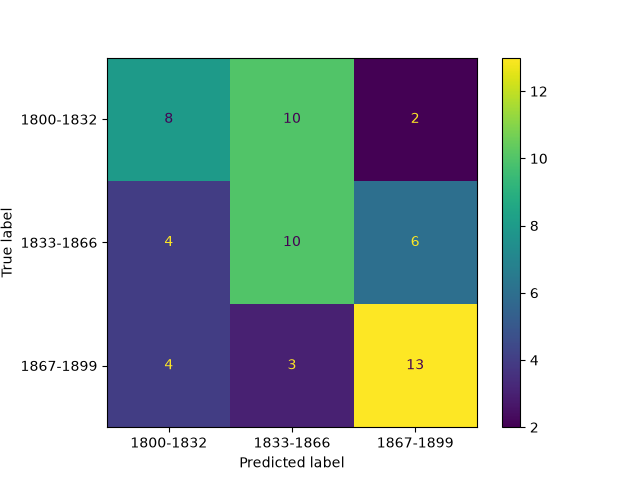
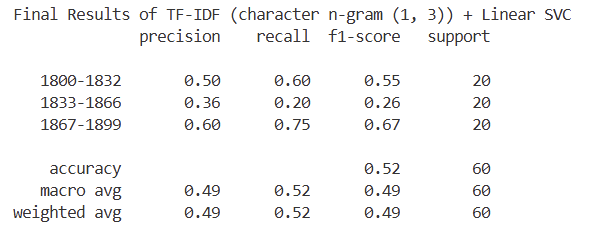
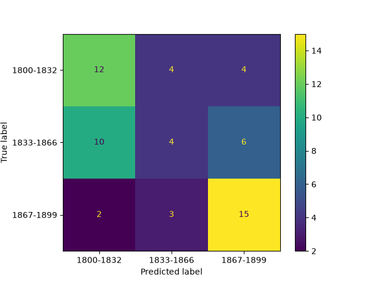

# Literary Time Classifier

Classifies English book excerpts into three periods of the 19th century:

- **1800–1832**
- **1833–1866**
- **1867–1899**

## Current status

- Dataset preparation is implemented using `biglam/blbooks-parquet`
  (this dataset source is based off TheBritishLibrary/blbooks).
- The preparation script targets 100 excerpts per period, filters for English-language text and OCR quality, and avoids repeated authors/publication names/record IDs.
- Train/test loading and an 80/20 split are implemented.
- Three classifiers are implemented:
  - **Qwen 2.5 3B (Ollama):** structured prediction, confidence score, and explanation.
  - **TF-IDF + Logistic Regression**
  - **Character TF-IDF (1–3 grams) + Linear SVM**
- Evaluation reports accuracy, precision, recall, F1-score, and a confusion matrix.
- Each model can provide results for a single input, which can be wired up to a frontend
  for user usage.

NOTE: SVC and SVM used interchangeably in repository.

## Project structure

```text
results/
    LLM_Cfs_Mtx.png
    LLM_clf_report.png
    TF_IDF_Lin_SVC_Cfs_Mtx.png
    TF_IDF_Lin_SVC_Clf_Report.png
    TF_IDF_Log_Reg_Cfs_Mtx.png
    TF_IDF_Log_Reg_Clf_Report.png
backend/
  requirements.txt
  data/
  scripts/
    prepare_dataset.py
    load_dataset.py
    LLM_Classifier.py
    ML_Classifier.py
    User_Response.py
    score.py
```

## Setup and run

Install Python dependencies:

```bash
pip install -r backend/requirements.txt
```

Prepare the dataset:

```bash
cd backend/scripts
python prepare_dataset.py
```

Then run the classifiers from `backend/scripts`:

```bash
python ML_Classifier.py # Run the scikit-learn models over the dataset
# or
python LLM_Classifier.py
```

The LLM classifier requires Ollama and the `qwen2.5:3b` model to be available locally.

## Model Results
Results of the models over a subset of the `biglam/blbooks-parquet` dataset.
  
  
qwen2.5:3b Results





  
  
TF-IDF + Logistic Regression Results
  

  



  

TF-IDF (character n-gram (1, 3)) + Linear SVC Results
  

  



## Outstanding work / limitations

- The dataset JSON files are not included in the supplied project archive; generate them before training or evaluation.
- TO-DO: The TypeScript frontend is not implemented
  (where user has option to put text and each model 
  responds with their prediction, confidence (except for svm), 
  and in llm case, reasoning.)
- Saved model files are written to the current working directory.
- The scoring script uses Matplotlib's `TkAgg` backend, which may require a local GUI environment.